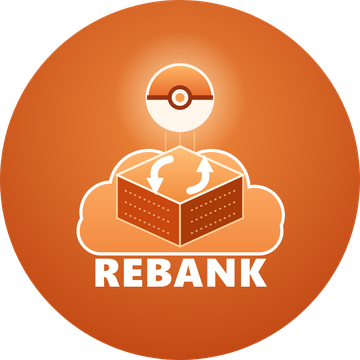
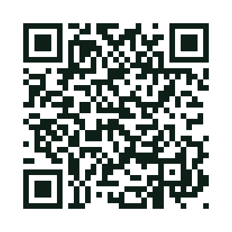
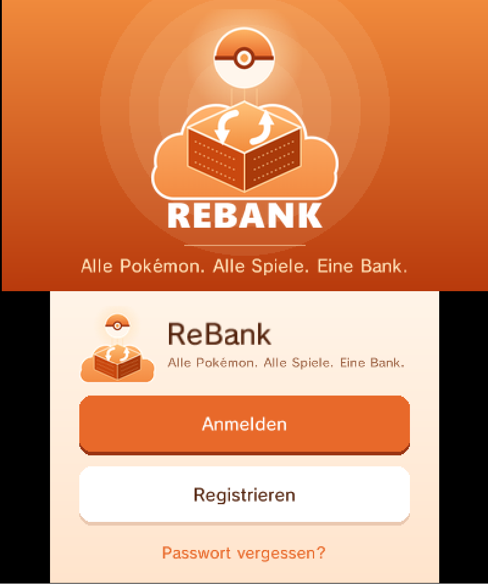
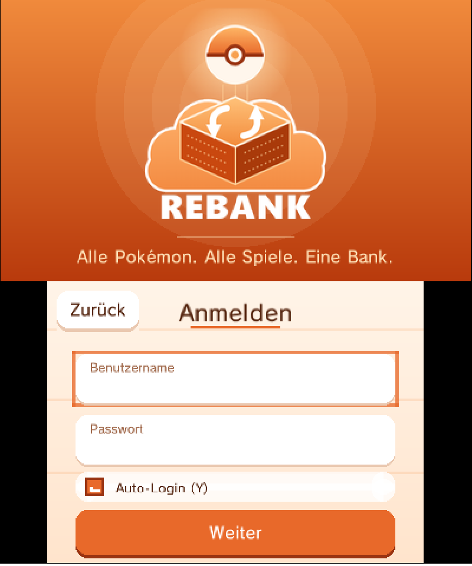
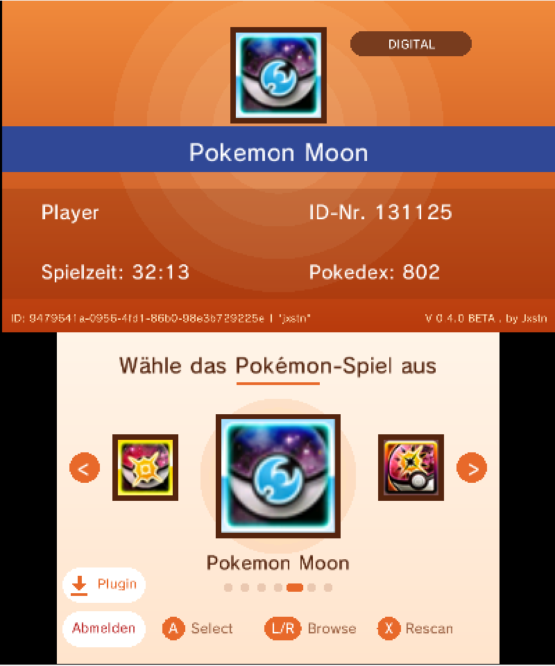
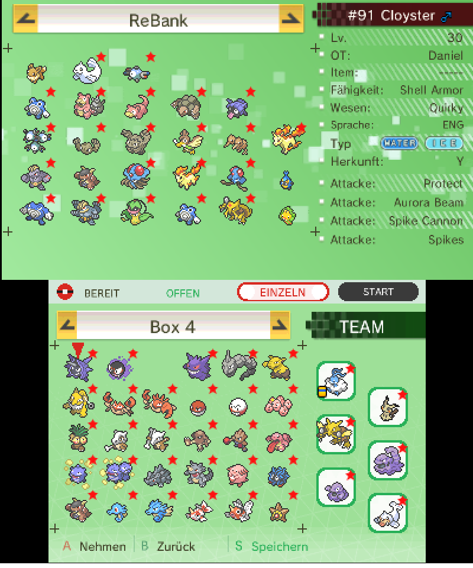

  

  # ReBank

  **Every Pokémon. Every game. One bank.**

  Free cloud storage for your Pokémon, right on your Nintendo 3DS.

  
  
  
  

 

## Why ReBank exists

For years, Pokémon Bank was the only official way to keep your Pokémon in the cloud and move them between games. Now it is being shut down, and many collections would be stuck on old cartridges and save files.

**ReBank fills that gap.** It is a free, independent cloud bank for your Pokémon, made for the Nintendo 3DS. No subscription, no official service needed, and no collection left behind.

 

## Install in 10 seconds

Have [FBI](https://github.com/Steveice10/FBI) installed? Open it, choose **Remote Install → Scan QR Code**, and scan this:

  

The link always serves the newest build, so the QR code never changes. It uses plain HTTP on purpose: the 3DS's certificate store is too old to trust most modern HTTPS certificates.

No FBI? Download `ReBank.cia`, `ReBank.3dsx` or `ReBank.3ds` from the **[Releases](../../releases)** page or from **[rebank.at](https://rebank.at)**.

After that, ReBank keeps itself up to date: it checks for new versions on start, shows the download and installation progress, and only installs updates signed by ReBank.

 

## Screenshots

  <table>
    <tr>
      <td align="center" width="50%">
         
        Welcome
      </td>
      <td align="center" width="50%">
         
        Sign in
      </td>
    </tr>
    <tr>
      <td align="center" width="50%">
         
        Pick a game
      </td>
      <td align="center" width="50%">
         
        Your cloud bank
      </td>
    </tr>
  </table>

 

## What you can do

**Your bank**

| | |
|---|---|
| **Cloud storage** | Move Pokémon from your game into your personal online bank and back whenever you want. Your collection no longer depends on a single cartridge. |
| **Party support** | See and manage the six Pokémon in your party right next to your boxes. |
| **Multi-select** | Press **Start** to grab a whole row or a rectangle of Pokémon and move, swap or drop them in one go. |
| **Trash Can** | Put Pokémon you no longer want into the trash box and delete them together, with a confirmation first. |
| **Box names** | Give your cloud boxes their own names, right from the box screen. |
| **Shiny and item badges** | Shiny Pokémon get a star and held items get an icon, right in the box. |
| **Event Pokémon** | Event Pokémon you claim from the cloud are made for the trainer of your loaded save and written straight into your game. |

**Your games**

| | |
|---|---|
| **Generation 1 to 7** | Pokémon move upward through the generations, from the Virtual Console games up to Sun and Moon. Origin game, trainer, IVs and everything else stay as they are. |
| **Cartridge detection** | Insert or swap a cartridge and ReBank picks it up on its own. |
| **NDS games as CIA** | Diamond to White 2 also work when you play them through an NDS forwarder; ReBank finds the game and its save on your SD card. |
| **Game library** | ReBank scans your SD card once and remembers your games, so later starts are fast. Press **X** in the game selection to scan again. |

**LiveBox plugin**

| | |
|---|---|
| **One-tap install** | The **Plugin** button in the game selection installs the ReBank LiveBox plugin for X, Y, Omega Ruby, Alpha Sapphire, Sun, Moon, Ultra Sun and Ultra Moon. ReBank turns on Luma's plugin loader for you and keeps any plugin you had before as a backup. |
| **Online features** | With the plugin, LiveBox, Festival Plaza, Battle Spot, GTS, Wonder Trade and Mystery Gift work through ReBank. |

**Account and safety**

| | |
|---|---|
| **Your own account** | Sign up with a username and password. Your session is stored encrypted on the console, so you do not have to log in every time. |
| **Safe transfers** | Transfers are checked for legality, and a failed transfer never duplicates or loses a Pokémon. |
| **Signed updates** | Updates and the plugin are only installed with a valid ReBank signature. |
| **Six languages** | English, German, French, Spanish, Italian and Portuguese, following your console's language. |

 

## Supported games

- **Generation 1 (Virtual Console)**: Red, Green, Blue, Yellow
- **Generation 2 (Virtual Console)**: Gold, Silver, Crystal
- **Generation 4**: Diamond, Pearl, Platinum, HeartGold, SoulSilver
- **Generation 5**: Black, White, Black 2, White 2
- **Generation 6**: X, Y, Omega Ruby, Alpha Sapphire
- **Generation 7**: Sun, Moon, Ultra Sun, Ultra Moon

 

## Getting started

1. Install ReBank: scan the QR code above with FBI, or download a file from the **[Releases](../../releases)**.
2. Open ReBank, create a free account and pick your game.
3. Start moving Pokémon into the cloud.

Your bank is also on the web: on **[rebank.at](https://rebank.at)** you can manage your boxes, look at your Pokémon in detail, trade and chat, right in the browser. Questions or ideas? Join the **[Discord](https://discord.rebank.at)**.

 

## How far it's come

- **0.1.x**: the foundation. Gen 4 to 7 saves, accounts, legality-checked transfers, pinned HTTPS and automatic updates.
- **0.2.x**: a new UI, party support, box names, the Trash Can, cartridge detection, Gen 1 and 2 Virtual Console support, the multi-select tool, safer transfers and signed updates.
- **0.3.x**: NDS games installed as CIA, game covers, a faster start, and the LiveBox plugin installer for Gen 6 and Gen 7, plus event Pokémon for your own trainer.
- **0.4.0**: a new orange design that matches the ReBank logo, a new icon and banner, an update screen with download progress, and reliable self-updates.

Every release with all details is on the **[Releases](../../releases)** page.

 

## A project made with care

ReBank is built and maintained independently, by someone who did not want years of collecting to disappear with a closing service. It keeps growing, with new features and fixes in nearly every update.

If something breaks, looks off or could be better, tell us. That feedback goes straight into the next update.

 

---

Licensed under [GPLv3](LICENSE). Built on some open-source components, see [NOTICE](NOTICE.md) for details. Pokémon and all related names, images and data are property of Nintendo, Game Freak and Creatures Inc. ReBank is an independent fan project, not affiliated with or endorsed by any of them.
